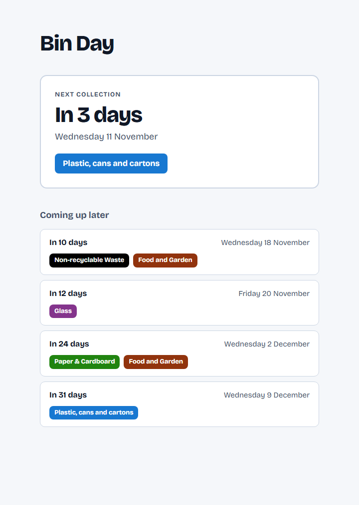

# Bin Day

A small site that shows when my next bin collection is and which bins are going out. Live at **https://bins.micmcgrorty.dev**.



This is a personal project, hard-wired to my address. It is built with [Remix 3](https://github.com/remix-run/remix) and runs on Node.

## How it works

Each page load fetches the schedule from the [ReCollect](https://recollect.net/) API, which my council uses to publish collection days. There is no database or cache.

- It asks for the next **42 days** of collections, working out "today" in **London time**.
- Collections on the same day are merged, and a bin listed twice on a day appears once.
- The page shows the **next collection** in a large card, then **up to four later ones**. Collections today or tomorrow are highlighted.
- Each bin is shown in the colour ReCollect gives it. If a colour is too light for white text, it is darkened just enough to meet WCAG AA contrast.
- If ReCollect fails or takes longer than 8 seconds, the page shows an error message instead.
- The page follows the system's light or dark setting. It does not refresh itself, so reload it to see changes.

## Getting started

You need **Node 24.3 or later**.

```sh
npm i
npm run dev
```

Then open http://localhost:44100.

## Configuration

Settings come from environment variables. `npm run dev` and `npm run start` also load a `.env` file from the project root if there is one (it's gitignored). Variables already set in your shell take precedence over the file.

| Variable               | Default    | Purpose                                     |
| ---------------------- | ---------- | ------------------------------------------- |
| `PORT`                 | `44100`    | The port the server listens on              |
| `RECOLLECT_PLACE_ID`   | my address | The ReCollect place to show collections for |
| `RECOLLECT_SERVICE_ID` | `50013`    | The ReCollect service (my council)          |

## Scripts

| Command              | What it does                                                |
| -------------------- | ----------------------------------------------------------- |
| `npm run dev`        | Runs the server and restarts it when files change           |
| `npm run start`      | Runs the server in production mode (no separate build step) |
| `npm test`           | Runs the tests with `remix test`                            |
| `npm run lint`       | Checks the code with oxlint (`lint:fix` fixes what it can)  |
| `npm run format`     | Formats the code with oxfmt (`format:check` only checks)    |
| `npm run type-check` | Type-checks with `tsc --noEmit`                             |

`npm run start` gets `NODE_ENV=production` from the committed `.env.production`, which is loaded after `.env` so it wins. That works in any shell, including PowerShell and cmd.

## Testing and CI

Tests sit next to the code they cover (`*.test.ts`). The app receives `fetch` and the current time as inputs, so tests swap in a fake ReCollect response and a fixed date and never touch the network.

- `app/data/collection-schedule.test.ts` covers fetching, grouping, ordering, colours and failures.
- `app/actions/controller.test.ts` renders the home page for each state the page can show.

GitHub Actions runs lint, format check, type-check and tests on every pull request.

## Project structure

```
server.ts                   Node HTTP server
app/
  routes.ts                 Route definitions (just "/")
  router.ts                 Wires routes to controllers; serves public/
  actions/                  Route handlers and the page document
  data/collection-schedule.ts   Fetches and shapes the ReCollect schedule
  ui/                       Page components, styles and light/dark theme
public/                     Favicon and self-hosted font, served as-is
```

For conventions to follow when changing the code, see [AGENTS.md](AGENTS.md).

## Credits

- Collection data from [ReCollect](https://recollect.net/).
- [Bricolage Grotesque](https://fonts.google.com/specimen/Bricolage+Grotesque) font, used under the SIL Open Font License (see `public/fonts/bricolage-grotesque-OFL.txt`).
